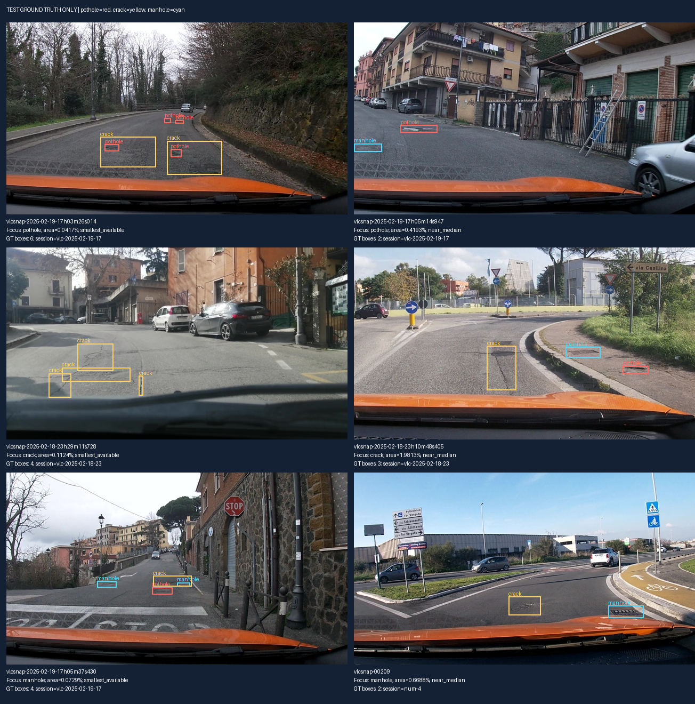

Họ tên: Nguyễn Văn Giáp
`dataset_version`: `d10-21e4070301`

## Bảng tổng hợp (số của bạn, lấy từ `report/evidence/*.json`)

Số E0–E4 lấy trực tiếp từ [e0.json](report/evidence/e0.json), [e1.json](report/evidence/e1.json), [e2.json](report/evidence/e2.json), [e3.json](report/evidence/e3.json) và [e4_rank_4.json](report/evidence/e4_rank_4.json). Cả năm cùng dataset `d10-21e4070301`, test 311 ảnh, thang norm1000 và không thiếu dự đoán. Đã đối chiếu [run E1](work/e1/run.json), [run E2](work/e2/run.json), [run E3](work/e3/run.json) và [run E4 rank 4](work/e4_rank_4/final/run.json): số tham số trainable, VRAM đỉnh và thời gian khớp chính xác với metadata của từng evidence. Cả bốn run hoàn tất 300 bước và có loss hữu hạn. E4 hiện có nhánh rank 4; chưa có nhánh rank 64 theo GUIDE. Dấu “—” biểu thị chưa có số đo. E0 không train, chưa có log VRAM hoặc thời gian suy luận.

| Mã | Setup | Tham số huấn luyện | VRAM đỉnh (GB) | Phút train | F1 | CI95 | FP/ảnh | F1 pothole | F1 crack | F1 manhole |
|---|---|---|---|---|---|---|---|---|---|---|
| E0 | zero-shot | 0 | — | 0 | 0,0601 | [0,0397; 0,0837] | 1,3408 | 0,1375 | 0,0034 | 0,1343 |
| E1 | LoRA LLM | 33.030.144 | 8,5783 | 45,4397 | 0,2563 | [0,2201; 0,2936] | 1,3408 | 0,1836 | 0,1813 | 0,5156 |
| E2 | + projector | 142.135.296 | 8,5863 | 45,8716 | 0,3401 | [0,2986; 0,3798] | 1,0289 | 0,1611 | 0,2924 | 0,5818 |
| E3 | + LoRA ViT | 148.426.752 | 12,0314 | 55,2266 | 0,4516 | [0,4100; 0,4930] | 0,8264 | 0,3318 | 0,3699 | 0,7034 |
| E4 r=4 | E3, rank 4, alpha 8 | 118.935.552 | 11,5923 | 54,8010 | 0,4296 | [0,3910; 0,4679] | 0,9228 | 0,2831 | 0,3664 | 0,6667 |

Phép so sánh và kiểm tra nhất quán được lưu ở [current_data.json](report/analysis/current_data.json), tái tạo bằng `python report/analyze_current_data.py` trong môi trường của lab. Script không huấn luyện/suy luận model hoặc ghi đè evidence.

## 10 câu hỏi (trả lời bằng **số của bạn**, không chép lại tài liệu)

### Câu 1 — Kiến trúc: ViT, projector và LLM của Qwen3-VL-4B có bao nhiêu tham số mỗi khối, và E1/E2/E3 mỗi cái cập nhật khối nào?

Đếm trên kiến trúc Qwen3-VL-4B ở thiết bị `meta`, dùng các kích thước trong [config model chính thức](https://huggingface.co/Qwen/Qwen3-VL-4B-Instruct/raw/main/config.json), cho kết quả:

| Khối | Số tham số |
|---|---|
| LLM, gồm embedding | 4.022.468.096 |
| ViT, gồm projector | 415.347.712 |
| ViT ngoài projector | 306.242.560 |
| `visual.merger` | 27.271.680 |
| `visual.deepstack_merger_list` | 81.833.472 |
| Projector, tổng hai nhóm trên | 109.105.152 |
| Tổng model | 4.437.815.808 |

Projector nằm trong ViT nên không cộng thêm vào tổng ViT. `lm_head` chia sẻ trọng số với embedding, không đếm hai lần. Đây là số tham số kiến trúc, không phải dung lượng trọng số 4-bit hay số tham số đã train.

- **E1:** cập nhật LoRA của attention/MLP LLM; đóng băng trọng số gốc LLM, ViT và projector. Run thực tế có **33.030.144** tham số trainable.
- **E2:** như E1, mở thêm toàn bộ projector fp32. Evidence ghi **142.135.296 = 33.030.144 + 109.105.152** tham số trainable; chênh lệch E2–E1 khớp chính xác số tham số projector.
- **E3:** như E2, thêm LoRA trên attention/MLP các block ViT; trọng số gốc các block ViT vẫn đóng băng. Evidence và run ghi **148.426.752** tham số trainable, thêm **6.291.456** so với E2. Log `matched_modules` xác nhận E2 có **252** module LoRA LLM; E3 có **348**, gồm **252 LLM + 96 ViT**, khớp 36 × 7 và 24 × 4 module.

### Câu 2 — E0: `parse_valid_rate` bằng bao nhiêu, và hai lỗi phổ biến nhất của model gốc là gì (kèm một ví dụ output thô)?

E0 có `parse_valid_rate = 0,6655948553`, tức **66,56% = 207/311** ảnh được parser chấp nhận; **104/311** không được chấp nhận. `missing_predictions = 0`, nên output không hợp lệ không phải do thiếu dòng dự đoán.

Hai nhóm vấn đề thấy được ở mức tổng hợp:

1. **Output không đáp ứng parser:** 104 ảnh. Parser kiểm tra cả cấu trúc và box hợp lệ, nên chưa thể quy tất cả thành lỗi cú pháp JSON.
2. **Nhận diện/định vị chưa đạt IoU 0,5:** **31 TP, 417 FP, 552 FN**, F1 **0,0601**. FN còn bao gồm GT trên ảnh có output không hợp lệ, nên hai nhóm này không độc lập để cộng lại.

Crack đặc biệt yếu: **1 TP, 288 FP, 298 FN**, F1 **0,0034**. FP chưa chứng minh model bịa box: box lệch, sai lớp hoặc box dư đều có thể tạo FP.

**Phần chưa đủ bằng chứng:** không có `work/e0.jsonl` hay output thô trong notebook. Chưa thể xếp hạng hai lỗi cụ thể trong sai thang/bịa box/sai lớp/JSON hỏng hoặc trích một output thật. Cần lấy lại JSONL từ phiên đã chạy; không dựng ví dụ thay cho output model.

### Câu 3 — Thang 0–1000: nếu chấm output theo pixel (hoặc ngược lại) thì F1 ra sao và vì sao? Bạn đã kiểm chứng điều này thế nào?

Đã kiểm chứng trên **311 ảnh test, 583 box GT**: chuyển nhãn thật thành JSON bằng `objects_to_answer()` của notebook, rồi gọi `evaluate()` trong `scripts/score.py` với hai lựa chọn `coord`.

| Thang output tổng hợp từ GT | Thang chấm | F1@IoU0,5 |
|---|---|---|
| norm1000 | norm1000 | **1,0000** |
| norm1000 | pixel | **0,0000** |
| pixel | norm1000 | **0,0000** |
| pixel | pixel | **1,0000** |

Ảnh là 640×360: `x_px = x_norm × 640/1000`, `y_px = y_norm × 360/1000`. Coi trực tiếp tọa độ norm1000 là pixel phóng tọa độ x khoảng **1,5625 lần**, y khoảng **2,7778 lần** so với đúng vị trí. Chiều ngược lại thu nhỏ x còn **0,64 lần**, y còn **0,36 lần**. JSON vẫn có thể hợp lệ nhưng box không đạt IoU yêu cầu.

Chỉ sai cách diễn giải tọa độ đã làm F1 từ 1 xuống 0 trong kiểm tra này. **Đây là output tổng hợp từ GT, không phải F1 mới của E0/E1 hoặc E4 coord_scale.** Thiếu JSONL dự đoán nên chưa đo được mức giảm riêng của hai model. Kiểm tra này không chạy lại model hoặc chọn checkpoint bằng test.

### Câu 4 — Mask loss: vì sao chỉ tính loss trên phần trả lời? Điều gì xảy ra nếu tính trên cả prompt và token ảnh?

Mục tiêu là học `P(JSON đáp án | ảnh, prompt)`. Prompt và token ảnh được cung cấp làm điều kiện, nên đặt `labels = -100` ở đó; chỉ đáp án và token kết thúc được tính loss. Mask loss vẫn cho phép gradient từ đáp án truyền qua projector/LoRA ViT khi setup mở những khối này.

Kiểm tra ảnh train **`20250216_164325`**, 640×360, với processor E1 đã lưu và `encode_example()` hiện tại:

- Chuỗi đầy đủ có **599 token**, gồm **220 token ảnh**. `image_grid_thw = [1,22,40]`; sau merge 2×2 có `22 × 40 / 4 = 220` token.
- **349 token** prompt/ngữ cảnh được mask; **250 token** được tính loss; **0 token ảnh** được tính loss.
- Prompt là tiền tố của full chat. Giải mã `labels != -100` thu đúng JSON **9 box**, rồi `<|im_end|>` và xuống dòng.

Nếu bỏ mask trong ví dụ này, cả **599 token** đều bị giám sát, gồm **220 token ảnh**. Loss còn tối ưu việc dự đoán lại phần điều kiện và placeholder ảnh, thay đổi mục tiêu và tăng trọng số cho phần không phải đáp án. Loss tổng có thể giảm mà định vị chưa cải thiện tương ứng. Chưa chạy ablation train bỏ mask nên không gán một mức giảm F1 cụ thể.

### Câu 5 — Vì sao không thể huấn luyện đầy đủ projector nếu ViT bị lượng tử hoá 4-bit, và bạn đã xử lý thế nào? Vì sao projector phải ở float32?

E2 cần cập nhật trực tiếp **109.105.152** tham số projector. Nếu các linear của projector thành `Linear4bit` với `Params4bit`, trọng số là dạng nén dùng cho QLoRA; đường train này giữ trọng số gốc cố định và cập nhật adapter, không full fine-tune trọng số nén bằng AdamW thông thường.

Lỗi gặp trong lab là skip `"visual"` trong khi module thật bắt đầu bằng `"model.visual"`. Với Transformers 5.19, prefix ngắn này không bảo vệ các lớp con. Đã sửa hàm nạp model thành:

```python
llm_int8_skip_modules=["model.visual", "lm_head"]
```

`verify_base_precision()` kiểm tra cả lớp `Linear4bit`/`Linear8bitLt`, kiểu `Params4bit`/`Int8Params` và dtype của các trọng số được bảo vệ trước khi train. Dtype đơn thuần chưa đủ vì `Params4bit` có thể là float trước khi pack. Phải nạp lại model; `.float()` trên trọng số nén không khôi phục trọng số pretrained fp32 gốc. Đã đối chiếu [mã so khớp của Transformers 5.19](https://github.com/huggingface/transformers/blob/v5.19.0/src/transformers/quantizers/quantizers_utils.py#L24).

Vòng train của lab giữ projector trainable ở **fp32** để lưu/cập nhật tham số và gradient ổn định hơn fp16, đồng thời tương thích với bước unscale của GradScaler. Forward vẫn autocast fp16. Đây là lựa chọn cho vòng train hiện tại, không có nghĩa mọi phương pháp huấn luyện đều bắt buộc dùng fp32 cho projector. ViT ngoài projector và `lm_head` giữ fp16; LLM gốc dùng NF4 4-bit.

Kiểm thử trước đó trên kiến trúc `meta` xác nhận E2 khớp **252 module LoRA**, mở đúng **109.105.152** tham số projector fp32. Run E2 hiện xác nhận **252 module** và **142.135.296** tham số trainable, khớp evidence; F1 đạt **0,3401**. Run E3 xác nhận **348 module**, **148.426.752** tham số trainable và `train_projector=true`. Cả hai chạy đủ **300 bước** với loss hữu hạn. Notebook lưu riêng projector trong `extra_trainable.pt` và nạp lại cùng adapter khi suy luận; workspace hiện mới có run log, chưa có trọng số E2/E3 để kiểm tra độc lập nội dung checkpoint và dtype thực tế.

### Câu 6 — Split theo phiên quay: vì sao chia ngẫu nhiên sẽ cho F1 cao giả? Số ảnh và số box từng lớp ở mỗi split là bao nhiêu?

Frame gần nhau trong video có cảnh nền và đối tượng gần giống nhau. Chia ngẫu nhiên theo ảnh dễ đưa các frame gần trùng vào train lẫn test, làm F1 có thể cao hơn khả năng tổng quát sang phiên quay mới. Chia nguyên nhóm session giúp giảm rò rỉ này.

Đếm trực tiếp các JSONL và đối chiếu `data/splits/meta.json`:

| Split | Ảnh | Nhóm session | pothole | crack | manhole | Tổng box |
|---|---|---|---|---|---|---|
| train | **1.422** | **13** | **1.074** | **1.750** | **691** | **3.515** |
| val | **276** | **2** | **66** | **470** | **103** | **639** |
| test | **311** | **3** | **121** | **299** | **163** | **583** |
| Tổng | **2.009** | **18** | **1.261** | **2.519** | **957** | **4.737** |

Giao nhau session ở train/val, train/test và val/test đều **rỗng**. Đây là các nhóm trong trường `session`, gồm cả nhóm `num-*`. Val chỉ có **66 box pothole** so với **470 crack**, nên cần đọc F1 từng lớp. Chưa chạy random split để đo mức tăng F1; giải thích rò rỉ dựa trên cấu trúc dữ liệu, không phải phép so sánh random/session đã chạy.

### Câu 7 — So sánh E1/E2/E3: mở projector và LoRA trên ViT có đáng không (F1, CI95, VRAM, thời gian)?

E1/E2/E3 đều có parse rate **100%**. Kết quả tổng hợp tăng dần: F1 **0,2563 → 0,3401 → 0,4516**, TP **147 → 185 → 245**, FP **417 → 320 → 257**, FN **436 → 398 → 338**. FP/ảnh giảm **1,3408 → 1,0289 → 0,8264**. E1 so với E0 tăng **19,62 điểm phần trăm** F1 và cải thiện parse rate **66,56% → 100%**.

| So sánh | Tăng F1 (điểm phần trăm) | Thêm tham số trainable | Thêm VRAM (GB) | Thêm phút train |
|---|---|---|---|---|
| E2 so với E1 | **8,38** | **109.105.152** | **0,0079** | **0,4319** |
| E3 so với E2 | **11,15** | **6.291.456** | **3,4452** | **9,3550** |
| E3 so với E1 | **19,53** | **115.396.608** | **3,4531** | **9,7869** |

Mở projector ở E2 cải thiện crack **0,1813 → 0,2924** và manhole **0,5156 → 0,5818**, nhưng pothole giảm **0,1836 → 0,1611**. Vì vậy lợi ích micro-F1 không đồng nghĩa mọi lớp đều tốt hơn. Thời gian chỉ tăng khoảng **0,95%**, VRAM gần bằng E1. Chênh VRAM **0,0079 GB** khớp giữa run log và evidence, nhưng rất nhỏ dù thêm 109M tham số trainable. Việc hai file khớp xác nhận tính nhất quán của số đã ghi, chưa xác nhận phép đo độc lập; cần kiểm tra cách reset/đo VRAM trước khi khẳng định chi phí tài nguyên của projector gần như bằng không.

Thêm LoRA ViT ở E3 cải thiện cả ba lớp so với E2: pothole **+17,06**, crack **+7,75**, manhole **+12,16 điểm phần trăm** F1. E3 dùng **12,0314 GB**, train **55,2266 phút**; so với E2 tăng khoảng **40,12% VRAM** và **20,39% thời gian**, đổi lại **+11,15 điểm phần trăm** micro-F1 và giảm **63 FP**. Chi phí cao hơn không chỉ phụ thuộc số tham số adapter, mà còn việc truyền gradient qua các block ViT.

Cả E1/E2/E3 dùng model Qwen3-VL-4B, NF4 4-bit, learning rate **2×10⁻⁴**, batch **2**, tích lũy **4**, **300 bước**, seed **42**, rank **16**, alpha **32**, dropout **0,05**. Log E2/E3 xác nhận **1.422 ảnh train**, train fraction **1,0**, warmup **5%**, weight decay **0** và max_new_tokens **256**. Learning rate đạt **0,0002** ở bước **15**, về **0** ở bước **300**; loss và grad_norm của cả hai đều hữu hạn.

| Setup | Bước tối ưu | Loss bước đầu | Loss bước cuối | Loss TB 20 bước đầu | Loss TB 20 bước cuối |
|---|---|---|---|---|---|
| E1 | **300** | **1,2049** | **0,5528** | **0,8481** | **0,5682** |
| E2 | **300** | **1,1903** | **0,4828** | **0,8466** | **0,5174** |
| E3 | **300** | **1,1903** | **0,4603** | **0,8381** | **0,4958** |

Tất cả 300 loss của mỗi setup đều hữu hạn, có xu hướng giảm nhưng dao động, không giảm đơn điệu. E2/E3 đạt loss cuối và trung bình cuối thấp hơn E1; việc cải thiện định vị được đánh giá bằng F1 test ở trên, không chỉ bằng loss train. Chưa có loss validation để đánh giá riêng mức overfitting.

Theo các evidence hiện có, **E3 là setup tốt nhất về F1** và là lựa chọn baseline cho E4 nếu ưu tiên chất lượng định vị. **E2 là phương án cân bằng** khi ưu tiên VRAM thấp: F1 cao hơn E1 với tài nguyên được ghi nhận gần tương đương, nhưng cần xác minh phép đo VRAM và chấp nhận chất lượng pothole thấp hơn. E1 có ít tham số trainable nhất, đồng thời F1 thấp nhất trong ba setup.

Run log đã xác nhận cấu hình huấn luyện chung, số bước, module LoRA và tài nguyên E2/E3. Tuy nhiên, run/evidence E0–E3 chưa ghi danh sách skip hoặc kết quả kiểm tra dtype ViT. Chưa xác nhận E0/E1 đã lưu dùng bản sửa `model.visual` hay chưa; nếu phạm vi lượng tử hóa khác nhau, so sánh E1 với E2/E3 chưa cô lập được hoàn toàn tác động mở khối. Chưa có trọng số checkpoint E2/E3 để xác minh dtype/projector đã lưu. Các kết luận trên là đánh giá bằng chứng hiện có với các giới hạn này.

### Câu 8 — Tập test có 311 ảnh: khoảng tin cậy rộng thế nào, và điều đó giới hạn kết luận so sánh các setup ra sao?

| Setup | F1 | CI95 | Độ rộng CI | Độ rộng theo điểm phần trăm |
|---|---|---|---|---|
| E0 | **0,0601** | **[0,0397; 0,0837]** | **0,0440** | **4,40** |
| E1 | **0,2563** | **[0,2201; 0,2936]** | **0,0735** | **7,35** |
| E2 | **0,3401** | **[0,2986; 0,3798]** | **0,0812** | **8,12** |
| E3 | **0,4516** | **[0,4100; 0,4930]** | **0,0830** | **8,30** |
| E4 r=4 | **0,4296** | **[0,3910; 0,4679]** | **0,0770** | **7,70** |

CI của các cặp kế tiếp không chồng nhau: cận dưới E1 **0,2201** cao hơn cận trên E0 **0,0837**; cận dưới E2 **0,2986** cao hơn cận trên E1 **0,2936** khoảng **0,0049**; cận dưới E3 **0,4100** cao hơn cận trên E2 **0,3798** khoảng **0,0302**. Thứ hạng F1 **E3 > E2 > E1 > E0** được hỗ trợ bởi các CI đã ghi nhận, nhưng vẫn có hạn chế về tính độc lập của ảnh và cấu hình ở câu 7.

`score.py` bootstrap **1.000 lần theo ảnh**, cộng TP/FP/FN rồi tính micro-F1. Test chỉ có **3 nhóm session**, và frame cùng session có thể tương quan. Vì vậy 311 ảnh không tương đương 311 cảnh độc lập; CI theo ảnh có thể đánh giá thấp bất định khi tổng quát sang phiên quay mới.

E4 rank 4 thấp hơn E3 rank 16 **2,20 điểm phần trăm** F1, nhưng hai CI chồng nhau ở **[0,4100; 0,4679]**. Chưa đủ bằng chứng để khẳng định giảm rank làm giảm chất lượng một cách có ý nghĩa thống kê; CI chồng nhau cũng không chứng minh hai rank tương đương.

Không kết luận setup hơn nhau chỉ vì F1 chênh vài điểm phần trăm. CI riêng từng setup chưa phải CI của hiệu F1; vì dùng cùng test, cần bootstrap ghép cặp theo cùng ảnh hoặc phân tích theo session để đánh giá chênh lệch trực tiếp. Thiếu output/TP-FP-FN từng ảnh nên chưa làm được phân tích đó. Đã có CI E4 rank 4, nhưng chưa có rank 64 hoặc lặp nhiều seed để đánh giá độ ổn định giữa các lần train.

### Câu 9 — Phân tích lỗi theo lớp: lớp nào kém nhất và vì sao (kích thước box, số mẫu, ngữ nghĩa)? Kèm ảnh minh hoạ.

E0 yếu nhất ở **crack**, F1 **0,0034**. Với E1, crack (**0,1813**) và pothole (**0,1836**) gần nhau, chênh **0,0023** chưa đủ kết luận chắc chắn. Ở E2 và E3, **pothole là lớp yếu nhất về điểm ước lượng**. E3 cải thiện pothole lên **0,3318**, nhưng vẫn thấp hơn crack **0,3699** và manhole **0,7034**; chưa có CI theo lớp để kiểm định chênh lệch.

| Lớp | Box train | Box test | F1 E1 | F1 E2 | F1 E3 | TP/FP/FN E3 | Trung vị diện tích box test | Tỷ lệ box test dưới 1% ảnh |
|---|---|---|---|---|---|---|---|---|
| pothole | **1.074** | **121** | **0,1836** | **0,1611** | **0,3318** | **35 / 55 / 86** | **0,4193%** | **77,69%** |
| crack | **1.750** | **299** | **0,1813** | **0,2924** | **0,3699** | **108 / 177 / 191** | **1,9813%** | **22,74%** |
| manhole | **691** | **163** | **0,5156** | **0,5818** | **0,7034** | **102 / 25 / 61** | **0,6688%** | **71,17%** |

E3 chỉ tìm đúng **35/121 pothole**, recall **28,93%**, còn **86 FN**. Crack vẫn tạo nhiều FP nhất: **177/257 FP** toàn bộ E3, khoảng **68,87%**. Manhole có precision **80,31%**, recall **62,58%**, cao nhất ba lớp. Hướng cải thiện cần ưu tiên recall pothole và giảm FP crack, thay vì chỉ tối ưu F1 tổng.

E4 rank 4 giữ cùng thứ tự độ khó: pothole F1 **0,2831** (**31 TP / 67 FP / 90 FN**), crack **0,3664** (**109 / 187 / 190**), manhole **0,6667** (**98 / 33 / 65**). So với E3 rank 16, F1 lần lượt giảm **4,86 / 0,35 / 3,68 điểm phần trăm**. Pothole vẫn có recall thấp (**25,62%**); crack tạo **187/287 FP**, khoảng **65,16%** tổng FP. Các số này mô tả kết quả quan sát, chưa xác định được nguyên nhân sai khi thiếu dự đoán từng ảnh.

Pothole có nhiều box nhỏ, trung vị **0,4193%** ảnh, nên sai vài pixel dễ giảm IoU. Crack có nhiều mẫu train nhất và box test lớn hơn hai lớp khác: dữ liệu không ủng hộ giải thích crack kém vì ít mẫu hoặc box nhỏ nhất. Ảnh GT cho thấy crack có thể là vết nứt mảnh hoặc vùng gồm nhiều đường nứt; khoanh vùng và phân biệt với texture mặt đường là giả thuyết cần kiểm tra. Manhole thường có biên hình học rõ hơn, nhưng thiếu output từng ảnh để chứng minh đó là nguyên nhân model làm tốt hơn.

Hình dưới lấy **6 ảnh test thật**, chọn box nhỏ và gần trung vị cho mỗi lớp. Đỏ: pothole; vàng: crack; xanh: manhole. Tên ảnh, session và diện tích được ghi trong hình và JSON phân tích.



**Đây là box GT, không phải box dự đoán.** Hình minh họa độ khó dữ liệu, chưa đáp ứng yêu cầu ảnh dự đoán đúng/sai có prediction và GT trong RUBRIC. Cần lấy lại JSONL dự đoán, ưu tiên E3 là setup tốt nhất, để chọn FP/FN/TP và kiểm tra các giả thuyết trên.

### Câu 10 — E4: bạn đổi biến nào, kết quả thế nào, và kết luận có đáng tin không?

**Biến thay đổi là rank LoRA**, trên baseline **E3** có micro-F1 cao nhất trong E1–E3. Nhánh đã chạy là **E4_RANK_4: r=4, alpha=8**, so với E3 **r=16, alpha=32**. Alpha đổi theo quy tắc `alpha = 2 × r` của GUIDE, nên tỷ lệ `alpha/r = 2` được giữ nguyên. LoRA vẫn áp dụng cho LLM và ViT, projector vẫn được mở đầy đủ.

Đối chiếu hai run cho thấy các thiết lập huấn luyện còn lại giữ nguyên: model `Qwen/Qwen3-VL-4B-Instruct`, NF4 4-bit, dropout **0,05**, learning rate **0,0002**, batch **2**, tích lũy **4**, **300 bước**, seed **42**, **1.422 ảnh train**, train fraction **1,0**, warmup **0,05**, weight decay **0**, thang **norm1000** và max_new_tokens **256**. Run E4 khớp **348 module LoRA**, đủ 300 loss hữu hạn; loss đầu/cuối **1,1903 / 0,4907**, trung bình 20 bước đầu/cuối **0,8746 / 0,4940**. Đây là đối chiếu cấu hình đã ghi; chưa có log kiểm tra dtype/skip ở từng run để xác nhận độc lập phạm vi lượng tử hóa thực tế.

Kết quả lấy từ [e4_rank_4.json](report/evidence/e4_rank_4.json); checkpoint final và [run.json](work/e4_rank_4/final/run.json) nằm ở `work/e4_rank_4/final/`, có adapter, `extra_trainable.pt` và processor/tokenizer.

| Chỉ số | E3 baseline, r=16 | E4, r=4 | Chênh lệch r=4 so với r=16 |
|---|---|---|---|
| Micro-F1 | **0,4516** | **0,4296** | **−2,20 điểm phần trăm** |
| CI95 | **[0,4100; 0,4930]** | **[0,3910; 0,4679]** | Chồng nhau |
| Precision / recall | **0,4880 / 0,4202** | **0,4533 / 0,4082** | Cả hai giảm |
| TP / FP / FN | **245 / 257 / 338** | **238 / 287 / 345** | **−7 / +30 / +7** |
| FP/ảnh | **0,8264** | **0,9228** | **+0,0965** |
| Parse valid / thiếu dự đoán | **100% / 0** | **100% / 0** | Cùng mức |
| Tham số trainable | **148.426.752** | **118.935.552** | **−29.491.200 (−19,87%)** |
| VRAM đỉnh (GB) | **12,0314** | **11,5923** | **−0,4391 (−3,65%)** |
| Phút train | **55,2266** | **54,8010** | **−0,4256 (−0,77%)** |

Giảm rank từ 16 xuống 4 giảm **75% tham số LoRA**: **39.321.600 → 9.830.400**. Tổng trainable chỉ giảm **19,87%** vì projector vẫn có **109.105.152** tham số, chiếm khoảng **91,73%** trainable của nhánh rank 4. VRAM và thời gian được ghi nhận chỉ giảm nhẹ; giảm rank không làm chi phí huấn luyện giảm tương ứng với số tham số adapter. Mean IoU của các cặp ghép thành công tăng **0,6851 → 0,6976**, nhưng TP giảm và FP tăng, nên không dùng chỉ số này để kết luận chất lượng phát hiện tổng thể tốt hơn.

**Kết luận từ nhánh hiện có:** rank 4 tiết kiệm tham số trainable, còn E3 rank 16 có F1 ước lượng cao hơn. Với test **311 ảnh thuộc 3 session**, CI E4 rộng **7,70 điểm phần trăm** và chồng với E3; chưa thể khẳng định chênh lệch **2,20 điểm phần trăm** là do rank một cách đáng tin cậy. Cần dự đoán từng ảnh để bootstrap ghép cặp và nhiều seed để đánh giá biến động huấn luyện.

**Giới hạn hoàn thành theo GUIDE:** ablation rank yêu cầu hai nhánh **r=4 và r=64**, đặt alpha tương ứng **8 và 128**. Hiện chỉ có evidence rank 4; baseline rank 16 giúp tham chiếu nhưng không thay thế nhánh rank 64. Vì vậy đã báo cáo đầy đủ kết quả E4 hiện có, còn thiếu `e4_rank_64.json` và run tương ứng để hoàn tất phép so sánh 4–64. Không suy ra chất lượng rank 64 hoặc rank tối ưu từ kết quả này.

## Nhìn lại

Lỗi đã gặp là ViT/projector bị lượng tử hóa do tên skip không khớp; E2 cần cập nhật toàn bộ projector nên lỗi lộ rõ khi setup/train. Cần kiểm tra lớp trọng số sau khi tải, lưu riêng projector và nạp lại cùng adapter.

E1 cải thiện JSON hợp lệ và TP nhưng FP vẫn **417**; E2/E3 lần lượt giảm FP còn **320/257** và tăng F1 lên **0,3401/0,4516**. E3 cho chất lượng tốt nhất với chi phí VRAM/thời gian cao hơn; pothole vẫn là điểm yếu và crack vẫn tạo phần lớn FP. Đúng định dạng chưa đồng nghĩa định vị tốt, và không nên quy mọi lỗi cho ít mẫu hoặc box nhỏ.

E4 rank 4 đạt F1 **0,4296** với **118.935.552** tham số trainable, giảm **19,87%** so với E3 rank 16, nhưng VRAM/thời gian chỉ giảm **3,65% / 0,77%**. Kết quả cho thấy lợi ích tiết kiệm tham số rõ hơn lợi ích tài nguyên được đo; CI chồng nhau và thiếu nhánh rank 64 nên chưa kết luận rank nào tối ưu.

Scorer tổng hợp chưa giải thích vì sao từng box sai, chưa xác nhận dtype/skip của run, và bootstrap theo ảnh chưa thể hiện đầy đủ phụ thuộc giữa frame cùng session. Cần log và output từng ảnh để kiểm tra.
